<p align="center">
  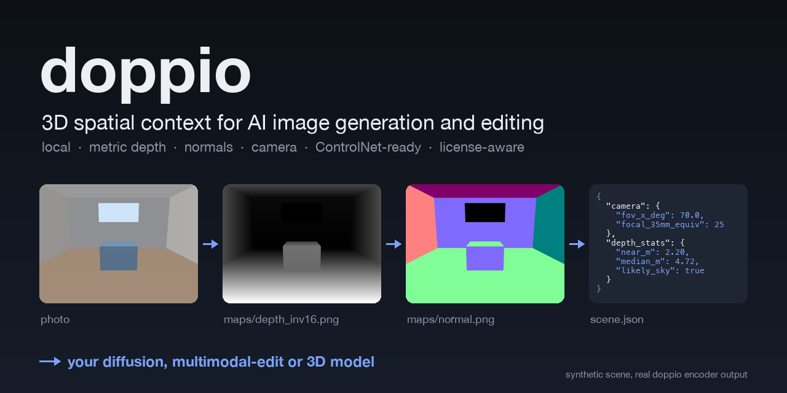
</p>

# doppio

**Local 3D spatial context for AI image generation and editing.**

doppio looks at a photo and measures its 3D layout: camera field of view,
metric depth, surface normals. It packages the result in formats image models
understand: ControlNet maps, a structured `scene.json`, a plain-language brief
for instruction editors, and raw arrays for 3D tools. Everything runs on your
machine, and only commercially licensed models are used unless you opt in.

<p>
  <a href="https://github.com/shaansundar/doppio/actions/workflows/ci.yml"></a>
  <a href="LICENSE"></a>
  
  
  
  
  
  
</p>

**Topics:** `depth-estimation` · `monocular-depth` · `surface-normals` · `camera-calibration` · `controlnet` · `image-editing` · `generative-ai` · `stable-diffusion` · `flux` · `comfyui` · `computer-vision` · `apple-silicon` · `local-first`

> **Status: alpha (v0.1).** The CLI, REST API, caching, license policy, depth/normal
> maps and camera intrinsics work today. Scene understanding (horizon, planes,
> objects), 3D exports and the MCP/ComfyUI/Photoshop integrations are on the
> [roadmap](#roadmap). Geometry benchmarks are still being collected; see
> [Benchmarks](#benchmarks).

## Contents

- [Why doppio](#why-doppio)
- [Features](#features)
- [Showcase: editing with and without doppio](#showcase-editing-with-and-without-doppio)
- [Quick start](#quick-start)
- [Install with an AI assistant](#install-with-an-ai-assistant)
- [Requirements and resource usage](#requirements-and-resource-usage)
- [Usage](#usage): [CLI](#cli) · [Output pack](#the-spatial-context-pack) · [REST API](#rest-api) · [With your models](#use-it-with-your-models)
- [Templates](#templates)
- [Benchmarks](#benchmarks)
- [Models and licenses](#models-and-licenses)
- [Configuration](#configuration)
- [How it works](#how-it-works)
- [Security and privacy](#security-and-privacy)
- [Troubleshooting and FAQ](#troubleshooting-and-faq)
- [Roadmap](#roadmap)
- [Contributing](#contributing)
- [License](#license)

## Why doppio

Image models edit pixels, not scenes. Ask one to "put a lamp next to the sofa"
and it guesses scale, perspective and occlusion from 2D cues. That is why
inserted objects float, shrink wrongly with distance, or ignore the vanishing
lines. Professional compositors solve this with camera and depth data. doppio
brings that data to AI workflows:

- **Retouchers and compositors**: give an editor the camera and depth it needs to place things believably.
- **Product, interior and architectural visualization**: keep generated content at the right scale and perspective.
- **Diffusion pipelines**: get clean, consistent depth and normal conditioning without running preprocessors in every workflow.
- **AI agents**: one local command turns "edit this photo" into measured context.

## Features

| Capability | Status |
|---|---|
| Camera intrinsics: FOV, focal length in pixels, 35 mm equivalent, EXIF focal prior | ✅ Available |
| Metric depth and camera-space point map (MoGe-2, MIT) | ✅ Available |
| Surface normals | ✅ Available |
| ControlNet-ready maps: 16/8-bit inverse depth, OpenGL normals, validity mask | ✅ Available |
| `scene.json` and `manifest.json` with published JSON Schemas | ✅ Available |
| CLI with an auto-started daemon, async REST API, job cancel and progress | ✅ Available |
| Content-addressed stage cache (re-runs and preset changes reuse work) | ✅ Available |
| License-aware model registry (commercial-only by default, pinned revisions) | ✅ Available |
| Prompt and workflow templates, benchmark harness | ✅ Available |
| Gravity, horizon line and vanishing points (GeoCalib, Apache-2.0) | 🔜 Phase 2 |
| Planes with corner-pin homographies, objects as 3D boxes, spatial relations (Florence-2 + SAM 2.1) | 🔜 Phase 3 |
| Point cloud / GLB / USD export, metric measure and placement queries | 🔜 Phase 4 |
| MCP server · ComfyUI nodes · Photoshop panel | 🔜 Phases 5–7 |
| Multi-view reconstruction from several photos (MapAnything, Apache-2.0) | 🔜 Phase 8 |

## Showcase: editing with and without doppio

We gave two AI agents the same 10 editing jobs. Each job was a photo with a hard
spatial layout and a request to add objects at specific places and real-world
sizes. Both agents were Claude Sonnet 5.5 with identical instructions, and both
made exactly one call to the same image editor, `gemini-2.5-flash-image`. The
only difference: one agent could run doppio, and the other worked from the photo
alone. A blind judge model compared each pair of results.

**Short version: on this test, doppio did not make the editor better on average.**
The judge preferred the doppio agent's edit for 4 photos and the photo-only
agent's for 3, and couldn't decide on 3. Mean overall scores were identical (5.5
out of 10). doppio's edits were clearly better when the hard part was distance:
where in the room something goes and how big it should be at that depth. They
were worse when the editor misread the measured placement. Using doppio added 7%
to the cost of an edit ($0.015) and 12 seconds.

### Where doppio helped

**Living room.** *"Add a 1.5 m black floor lamp between the left armchair and
the left sofa, and a ginger cat asleep under the coffee table."* doppio measured
the gap at 3.8–4.2 m from the camera, so the lamp stands behind the sofa in the
gap. Without doppio, the lamp ended up in front of the sofa. The judge picked the
doppio edit in both orders.

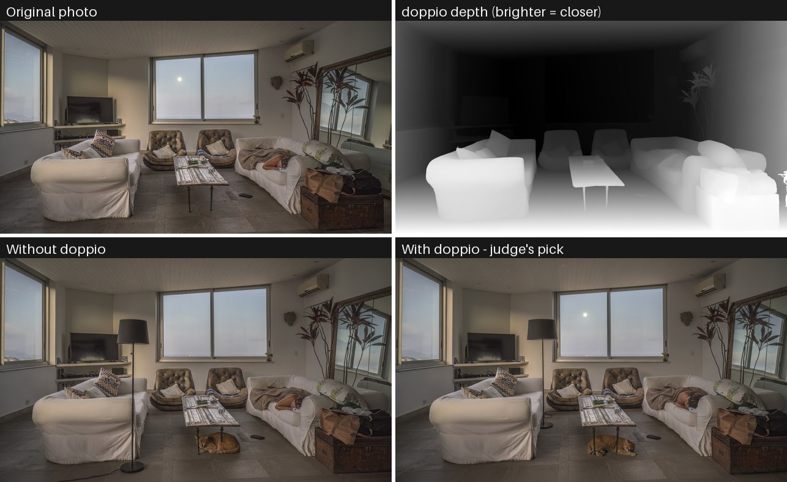

**Restaurant.** *"Add a waiter halfway back into the room, partly hidden behind
the chairs of a nearer table, and a bottle of red wine on the nearest table."*
doppio put the aisle 6.4 m away, so the waiter is smaller and further back.
Without doppio, he is too large and stands in front of the chairs. The judge
picked the doppio edit in both orders.

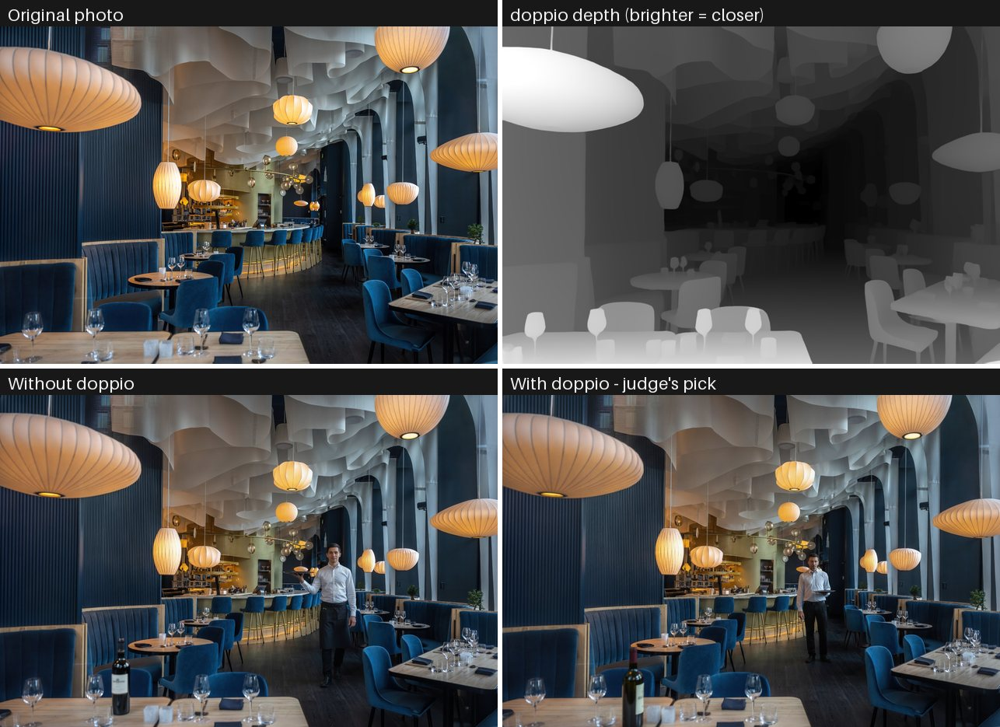

### Where it didn't

**Alley.** *"Place a 0.6 m wheelbarrow halfway up the alley against the right-hand
wall, and a black cat sitting on top of the left-hand wall near the front."* The
doppio agent described the cat's spot as a wall top 8.5 m away, partly behind a
roof edge, and the editor drew the cat clinging to the wall's vertical face. The
judge picked the photo-only edit in both orders, and also preferred its
wheelbarrow's scale and perspective.

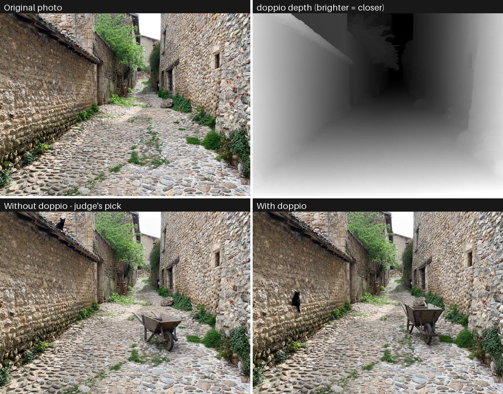

<details>
<summary>All 10 photos, with the judge's verdict</summary>

| Photo | Judge | What decided it |
|---|---|---|
| 01 Living room | with doppio | Lamp in the sofa–armchair gap instead of in front of the sofa |
| 02 Library | split | Neither put the librarian two-thirds of the way back; both have scale problems |
| 03 Abandoned hall | split | Similar placements; the judge traded the lighting of one against the perspective of the other |
| 04 Station plaza | without doppio | The photo-only bus sits behind the barriers and cars; the doppio bus covers foreground objects |
| 05 Restaurant | with doppio | Waiter at the right depth and size, partly behind chairs |
| 06 Alley | without doppio | doppio edit's cat clings to the wall face |
| 07 Hotel corridor | with doppio | Woman far down the corridor (doppio measured 17.5 m) and cart on the rug; the photo-only woman walks sideways in the wrong place |
| 08 Courtyard | split | The doppio statue is better lit but too large and crowds the flower bed |
| 09 Wide-angle house | with doppio | Rocking chair with correct floor contact; the photo-only edit distorts the fan |
| 10 Classroom | without doppio | The doppio edit has the right row but adds an oversized open book and looks pasted in |

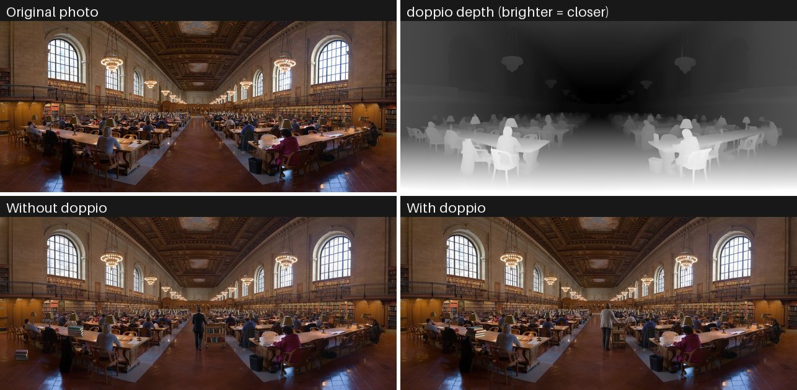
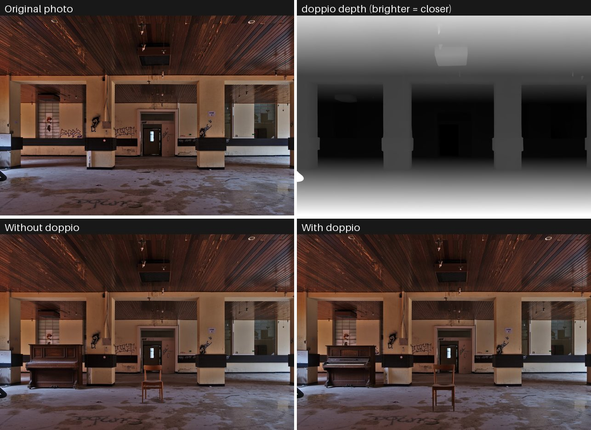
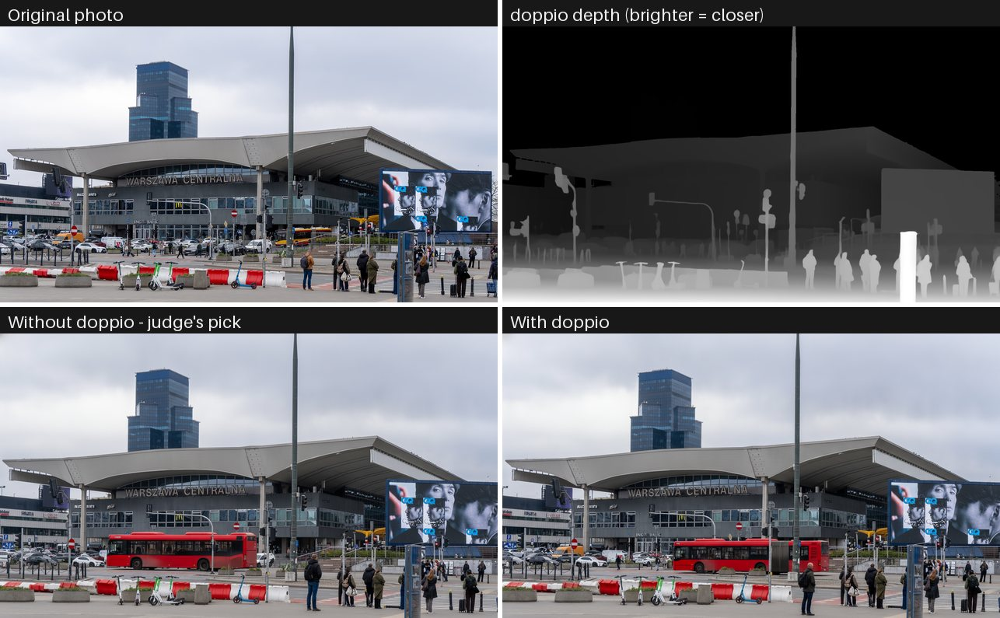
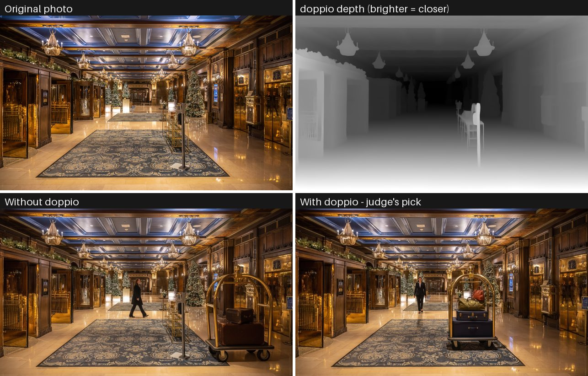
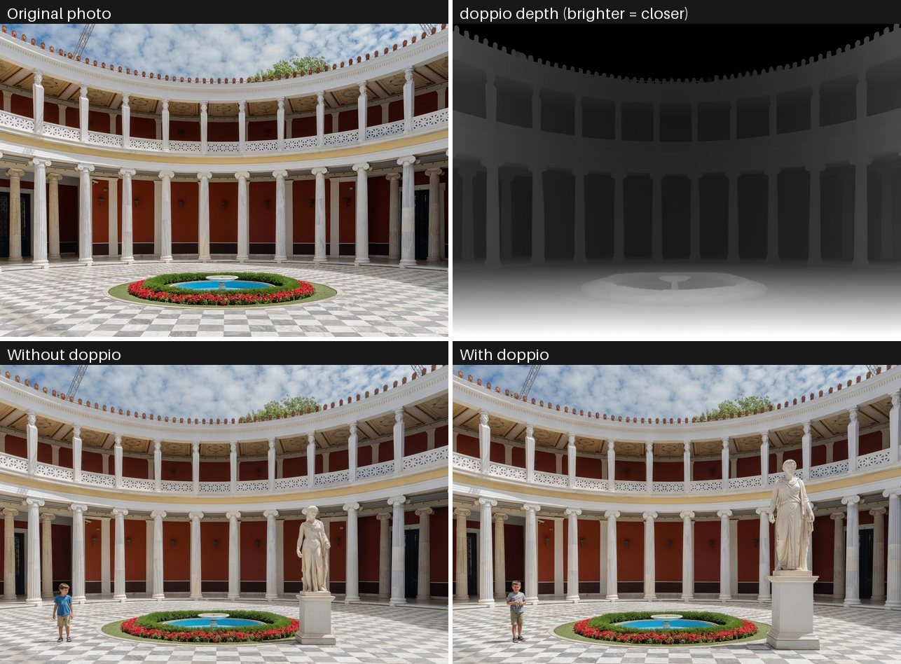
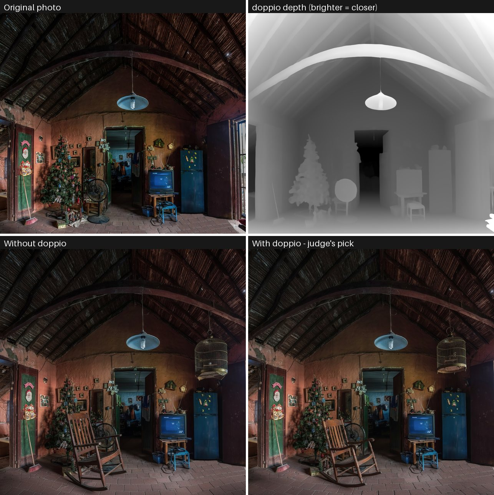
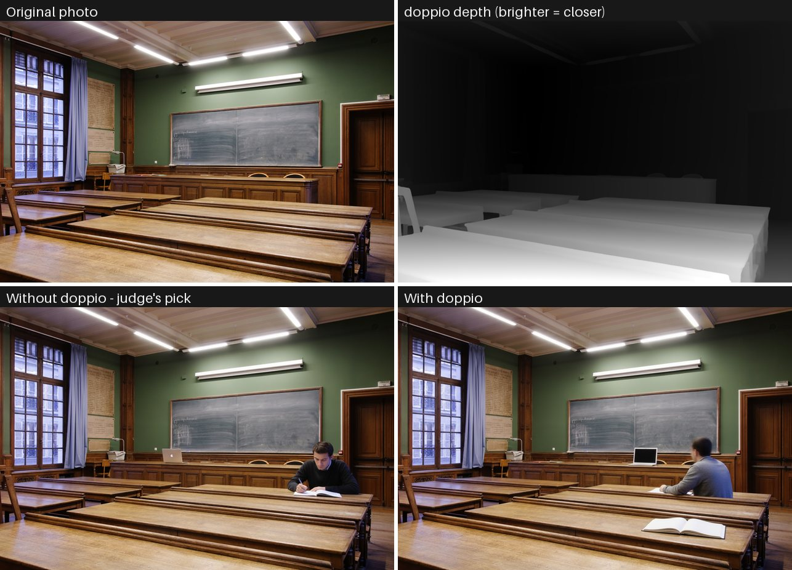

</details>

### Judge scores

The judge, `gemini-3.1-pro-preview`, saw the original, the request and the two
edits labelled only A and B. It didn't know which agent made which, or that
doppio exists. Each pair was judged twice with the order swapped. An edit wins a
photo only if it wins both times; otherwise the photo is "split".

| Verdict | Photos |
|---|---|
| With doppio wins | 4 |
| Without doppio wins | 3 |
| Split (the judge changed its mind when the order was swapped) | 3 |

| Criterion (mean of 20 judgments, 1–10) | Without doppio | With doppio | Change |
|---|---|---|---|
| Instruction following | 5.8 | 6.0 | +0.2 |
| Placement and contact | 6.0 | 5.5 | −0.4 |
| Scale | 5.8 | 5.5 | −0.2 |
| Perspective | 6.0 | 6.0 | 0.0 |
| Occlusion | 6.5 | 6.4 | 0.0 |
| Lighting and shadows | 6.1 | 5.8 | −0.2 |
| Preservation of the rest of the photo | 6.7 | 7.2 | +0.6 |
| **Overall** | **5.5** | **5.5** | **0.0** |

### What it cost

Averages per edit. Token counts are exact: Claude's from the agents' transcripts,
Gemini's from the API's usage metadata. Costs use API list prices on 2026-11-13.

| Per edit | Without doppio | With doppio | Change |
|---|---|---|---|
| Claude input tokens (mostly cache reads) | 201,823 | 303,798 | +51% |
| Claude output tokens | 2,662 | 3,244 | +22% |
| Claude API requests | 4.0 | 5.7 | +42% |
| Claude cost | $0.157 | $0.172 | +9% |
| Gemini input tokens | 775 | 1,374 | +77% |
| Gemini output tokens (one image) | 1,290 | 1,290 | 0% |
| Gemini cost | $0.0389 | $0.0391 | +0.5% |
| **Total cost** | **$0.196** | **$0.211** | **+7%** |
| Agent time | 35 s | 46 s | +12 s |
| doppio analysis (Apple M4, `standard` preset) | | 2.6 s | |

Most of the extra cost is the agent's extra steps: running doppio, reading
`scene.json` and measuring distances re-sends its context, mostly from cache.
The depth map adds about 600 input tokens to the Gemini call, which is almost
free next to the output image. Judging all 10 pairs cost $0.73.

### How the test worked

- **Photos:** 10 openly licensed photos from Wikimedia Commons, chosen for hard
  geometry: wide-angle lenses, long depth, occlusion, slopes and reflective floors.
- **Requests:** one per photo, written before any agent ran, naming real-world
  sizes so scale can be checked
  ([`requests.json`](scripts/showcase/requests.json)).
- **Agents:** two Claude Sonnet 5.5 subagents per photo, in Claude Code, with
  briefs that differ only in one rule
  ([`agent_brief.md`](scripts/showcase/agent_brief.md)). The doppio agent followed
  doppio's [agent workflow](templates/prompts/agent-system-prompt.md): `doppio
  analyze --preset standard`, read `scene.json`, build the prompt with
  [`build-prompt.sh`](templates/scripts/build-prompt.sh), and attach
  `depth_inv8.png`.
- **Editor:** `gemini-2.5-flash-image`, one call per edit, no retries, inputs
  resized to 1536 px for both agents. Neither agent saw its result.
- **Judge:** blind and pairwise as described above, with a fixed rubric
  ([`judge.py`](scripts/showcase/judge.py)).

**Caveats.**
- **Sample size:** with 10 photos and one edit per agent, these results are anecdotes, not statistics.
- **One editor:** the test used one instruction editor, which treats the depth map as a hint. Diffusion pipelines that take depth as a hard ControlNet condition, doppio's main target, weren't tested.
- **Model judge:** the judge is a model, and it changed its verdict when the order was swapped in 3 of the 10 photos.
- **Agent model:** a pilot on photo 01 with Claude Opus 5.5 agents cost about $1.75 per agent, so the full run used Sonnet 5.5.

**Reproduce.** You need a working doppio (`bin/doppio doctor`), `GEMINI_API_TOKEN`
or `GOOGLE_AI_API_KEY`, and an agent runner such as Claude Code:

```sh
python3 scripts/showcase/fetch_cases.py      # photos and licenses into ./showcase (git-ignored)
python3 scripts/showcase/prepare_runs.py     # one brief.md per photo and agent
# Run one agent per brief: "Read <brief.md> and carry it out exactly."
worker/.venv/bin/python scripts/showcase/judge.py
worker/.venv/bin/python scripts/showcase/report.py   # tables, local gallery.html, README images
```

<details>
<summary>Photo credits</summary>

All photos are from Wikimedia Commons. The showcase images are edited versions
(AI-added objects, and a depth map rendered by doppio).

| Photo | Author | License |
|---|---|---|
| [Living room, Edifício Zaher, Rio de Janeiro](https://commons.wikimedia.org/wiki/File:Living_room_in_apartment_of_Condom%C3%ADnio_do_Edif%C3%ADcio_Zaher,_Le_Blond,_Rio_de_Janeiro,_Brazil.jpg) | Wilfredor | [CC0](https://creativecommons.org/publicdomain/zero/1.0/) |
| [NYC Public Library Research Room](https://commons.wikimedia.org/wiki/File:NYC_Public_Library_Research_Room_Jan_2006-1-_3.jpg) | Diliff | [CC BY 2.5](https://creativecommons.org/licenses/by/2.5) |
| [Sanatorium du Basil, Stoumont](https://commons.wikimedia.org/wiki/File:Large_room_leading_to_the_kitchen_in_Sanatorium_du_Basil,_Stoumont,_Belgium_(DSCF3534-hdr).jpg) | Trougnouf | [CC BY 4.0](https://creativecommons.org/licenses/by/4.0) |
| [Warszawa Centralna train station](https://commons.wikimedia.org/wiki/File:Warszawa_Centralna_train_station,_2026,_Warsaw,_Poland.jpg) | Igor123121 | [CC BY 4.0](https://creativecommons.org/licenses/by/4.0) |
| [Restaurant in Place D'Youville, Quebec City](https://commons.wikimedia.org/wiki/File:Restaurant_in_Place_D%27Youville,_Quebec_City.jpg) | Wilfredor | [CC0](https://creativecommons.org/publicdomain/zero/1.0/) |
| [Rue du Souterrain, Pérouges](https://commons.wikimedia.org/wiki/File:Rue_du_Souterrain_depuis_la_rue_des_Rondes_%C3%A0_P%C3%A9rouges_en_avril_2021.jpg) | Benoît Prieur | [CC0](https://creativecommons.org/publicdomain/zero/1.0/) |
| [Frontenac Hotel, Quebec City](https://commons.wikimedia.org/wiki/File:Frontenac_Hotel,_Quebec_ville,_downtown_007.jpg) | Wilfredor | [CC0](https://creativecommons.org/publicdomain/zero/1.0/) |
| [Courtyard of the Zappeion, Athens](https://commons.wikimedia.org/wiki/File:Courtyard_Zappeion_Athens,_Greece.jpg) | Jebulon | [CC0](https://creativecommons.org/publicdomain/zero/1.0/) |
| [Old house, Margarita Island](https://commons.wikimedia.org/wiki/File:Old_house_typical_of_the_island_of_Margarita.jpg) | Wilfredor | [CC0](https://creativecommons.org/publicdomain/zero/1.0/) |
| [Grande salle, École nationale des chartes](https://commons.wikimedia.org/wiki/File:Grande_salle_ENC_n1.jpg) | Marie-Lan Nguyen | [CC BY 2.5](https://creativecommons.org/licenses/by/2.5) |

</details>

## Quick start

```sh
# Prerequisites: macOS on Apple Silicon (or Linux), Go 1.25+, uv, git.
#   macOS: brew install go uv jq
git clone https://github.com/shaansundar/doppio.git
cd doppio

make build            # → bin/doppio
make worker-setup     # Python worker environment (PyPI packages only, ~0.9 GB)
bin/doppio setup      # MoGe-2 geometry backend (pinned GitHub sources, see below)
bin/doppio doctor     # every line should read [ok  ]

bin/doppio analyze photo.jpg --preset fast
```

Example output (illustrative numbers):

```text
Analyzed photo.jpg  1024x768  preset fast  2.1s
  camera  65.5° x 51.4° FOV, 28 mm equiv. (exif+model)
  depth   0.84 m to 9.71 m (median 3.02 m), 91% valid
  models  moge2-vits-normal (MIT); commercial use OK
  pack    photo.doppio  (scene.json, maps/, arrays/)
```

The first analysis downloads the model weights from Hugging Face: 134 MB for
`fast`, 1.2 GB for `standard`/`full`. `bin/doppio stop` stops the background daemon.

> **Why a separate `setup` step?** MoGe-2 and two of its dependencies
> (`EasternJournalist/utils3d`, `EasternJournalist/pipeline`) are installed from
> GitHub at pinned commits rather than PyPI, so doppio asks you to opt in explicitly.

## Install with an AI assistant

Paste this prompt into Claude Code, Cursor, Codex, Windsurf or any assistant
that can run terminal commands. It installs doppio step by step, stops for your
approval before any non-PyPI download, and verifies the install. It is also in
[`templates/prompts/install-with-ai.md`](templates/prompts/install-with-ai.md).

```text
Install **doppio** (https://github.com/shaansundar/doppio), a local tool that gives image generation and editing models 3D context (camera, metric depth, normals) about a photo. Run the commands yourself, show me the important output, and follow these rules:

- Do not use `sudo`, change system settings, or edit my shell profile without asking.
- Stop and ask me before anything that downloads code from outside PyPI, the Go module proxy, or Homebrew.
- Never make the doppio daemon listen on anything other than 127.0.0.1.
- If a step fails, show me the error, explain the likely cause, and propose a fix before retrying.

Steps:

1. **Check the platform and tools.** Report the results of `uname -sm`, `sw_vers` (macOS), `go version` (needs 1.25 or newer), `uv --version`, `git --version`, `jq --version` (optional), free disk space in my home directory (needs about 3 GB), and total RAM (8 GB minimum, 16 GB recommended).
   - The primary target is Apple Silicon macOS. Linux with an NVIDIA GPU or CPU-only also works.
   - If Go, uv or jq is missing, propose installing it (macOS: `brew install go uv jq`; uv elsewhere: https://docs.astral.sh/uv/getting-started/installation/) and wait for my approval.
2. **Get the code.** Run `git clone https://github.com/shaansundar/doppio.git && cd doppio`. If the folder already exists, `cd` into it and run `git pull --ff-only` instead.
3. **Build the CLI.** Run `make build`. It should produce `bin/doppio`; confirm with `bin/doppio version`.
4. **Create the worker environment** (PyPI packages only, about 0.9 GB): `make worker-setup`.
5. **Ask me before this step.** `bin/doppio setup` installs the MoGe-2 geometry model code (MIT, from github.com/microsoft/MoGe at a pinned commit) plus two pinned GitHub dependencies (EasternJournalist/utils3d and EasternJournalist/pipeline). Model weights (134 MB for fast, 1.2 GB for standard/full, MIT) download from Hugging Face on first use. Explain this to me and run it only after I say yes.
6. **Verify.** Run `bin/doppio doctor` and show me the output. Every line should start with `[ok  ]`; diagnose any `FAIL`.
7. **Smoke test.** Ask me for an image path (or use any JPEG/PNG I point you to), then run `bin/doppio analyze <image> --preset fast`. Show the summary and list the files in the created `<name>.doppio/` folder. The first run downloads the model weights, so allow a few minutes.
8. **Optional:** offer to add `bin/` to my PATH (ask first) and to stop the background daemon with `bin/doppio stop`.

Finish with a short summary: what was installed, where (`~/Library/Application Support/doppio`, `~/Library/Caches/doppio`, the repo's `worker/.venv`), how much disk it used, and the next commands to try:

- `bin/doppio analyze photo.jpg`
- `templates/scripts/build-prompt.sh photo.doppio "your edit"`
- the system prompt in `templates/prompts/agent-system-prompt.md`
```

To let an agent **use** doppio while editing images (not just install it),
give it [`templates/prompts/agent-system-prompt.md`](templates/prompts/agent-system-prompt.md).

## Requirements and resource usage

| | Minimum | Recommended |
|---|---|---|
| Hardware | Apple Silicon (M1 or later), or x86-64/arm64 Linux | M-series with 16 GB, or an NVIDIA GPU |
| Memory | 8 GB (`fast` preset)¹ | 16 GB (`standard` / `full`)¹ |
| Disk | ~1.1 GB: worker env 0.9 GB + ViT-S weights 134 MB | ~3 GB, plus caches capped at 20 GB (stages) and 5 GB (packs) by default |
| Software | Go 1.25+, uv, git | jq for templates |

¹ Guidance from model sizes; not yet confirmed by geometry benchmarks.

**Measured overhead** (Apple M4, 16 GB; details in [docs/benchmarks.md](docs/benchmarks.md)):

| | Memory (RSS) | CPU when idle |
|---|---|---|
| Daemon `doppio serve` | 18 MB | 0.0 % |
| Worker with torch loaded, no model | 241 MB | 0.0 % |
| Worker cold start | 3.1 s | – |
| Ingest a 12 MP JPEG → 2048 px | 236 MB peak, 94 ms | – |
| Maps at 2048 px | 243 MB peak, 76 ms | – |

Only one analysis runs on the GPU at a time. Loaded models are kept in memory
under a budget (`--max-resident-gb`, default 6) and the least recently used one
is evicted when the budget is exceeded.

## Usage

### CLI

```sh
doppio analyze IMAGE [flags]          # analyze and download the pack to ./<image>.doppio
doppio analyze room.jpg -p fast -o ./ctx
doppio analyze room.jpg --json | jq .camera
doppio analyze room.jpg --no-exif-prior --geometry-model moge2-vitb-normal

doppio models list [--all] [--json]   # registry, licenses, sizes
doppio doctor                         # check install, worker device, daemon
doppio serve                          # run the daemon in the foreground
doppio stop                           # stop the background daemon
doppio setup [--no-moge]              # (re)create the worker environment
```

| `analyze` flag | Default | Meaning |
|---|---|---|
| `-p, --preset` | `standard` | `fast` (ViT-S, 1024 px), `standard` (ViT-L, 2048 px), `full` (ViT-L, 3072 px) |
| `-o, --out` | `./<image>.doppio` | Where to write the pack |
| `--json` | off | Print `scene.json` to stdout instead of a summary |
| `--allow-noncommercial` | off | Allow models whose license forbids commercial use |
| `--geometry-model` | preset's | Override the geometry model (see `doppio models list`) |
| `--no-exif-prior` | off | Estimate the field of view purely from pixels |
| `--timeout` | `15m` | Give up after this long (the job is cancelled) |

Exit codes: `0` success, `1` failure, `2` invalid input (unreadable image, bad option).

### The Spatial Context Pack

```text
photo.doppio/
├── scene.json              camera, depth statistics, quality warnings
├── manifest.json           models + licenses, stage cache keys, sha256 of every file
├── image.png               working image (all pixel coordinates refer to it)
├── maps/
│   ├── depth_inv16.png     16-bit inverse depth, near = bright   → depth ControlNets
│   ├── depth_inv8.png      8-bit version
│   ├── normal.png          OpenGL normals (R right, G up, B toward viewer)
│   └── valid_mask.png      255 = geometry, 0 = sky / no data
└── arrays/
    ├── points.npy          H×W×3 float32 camera-frame points, meters, NaN = invalid
    ├── depth_metric.npy    H×W float32 metric depth, meters
    ├── normal.npy          H×W×3 float32 unit normals (OpenCV camera frame)
    └── valid_mask.npy      H×W bool
```

<p align="center">
  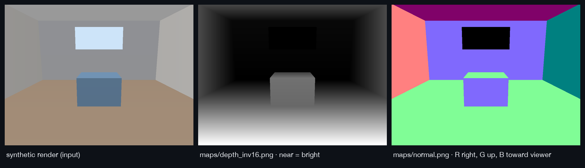
  <br><sub>A synthetic, ray-cast room passed through doppio's real map encoders. It shows the conventions, not model accuracy. The window has no geometry, so it is 0 (black) in both maps.</sub>
</p>

`scene.json` ([schema](schema/scp/v1/scene.schema.json), [full example](examples/scene.synthetic-room.json)):

```json
{
  "schema": "doppio.scene/v1",
  "image": { "width": 1024, "height": 768, "sha256": "…" },
  "camera": {
    "model": "pinhole", "fx": 731.2118, "fy": 731.2118, "cx": 512.0, "cy": 384.0,
    "fov_x_deg": 70.0, "fov_y_deg": 55.4129, "focal_35mm_equiv": 24.7165,
    "source": "model", "k": [[731.2118, 0, 512.0], [0, 731.2118, 384.0], [0, 0, 1]]
  },
  "depth_stats": { "near_m": 2.2035, "median_m": 4.7279, "far_m": 7.1196, "valid_fraction": 0.9598, "likely_sky": true },
  "quality": { "metric_scale": true, "warnings": [] }
}
```

Frames, units and encodings are specified in [docs/conventions.md](docs/conventions.md).
Consumers should ignore unknown fields; later v1 versions add `horizon`,
`planes`, `objects` and `relations`.

### REST API

The daemon listens on `127.0.0.1:7341`. Every endpoint except `/healthz` needs
the bearer token that doppio creates on first run.

```sh
TOKEN=$(cat "$HOME/Library/Application Support/doppio/token")   # Linux: ~/.config/doppio/token
API=http://127.0.0.1:7341

# Analyze and wait up to 60 s for the result
curl -s -H "Authorization: Bearer $TOKEN" \
     -F image=@room.jpg -F preset=fast "$API/v1/analyze?wait=60s" | jq '{status, pack_id, links}'

# Fetch the manifest and any artifact listed in it (ETag = sha256)
curl -s -H "Authorization: Bearer $TOKEN" "$API/v1/packs/$PACK" | jq '.artifacts[].path'
curl -s -H "Authorization: Bearer $TOKEN" -o depth.png "$API/v1/packs/$PACK/artifacts/maps/depth_inv16.png"
```

| Method | Path | Notes |
|---|---|---|
| `POST` | `/v1/analyze?wait=30s` | multipart: `image` (JPEG/PNG/WebP/TIFF/HEIC) plus optional `preset`, `allow_noncommercial`, `geometry_model`, `disable_exif_prior`. Returns `202` with a job, or `200` if it finished within `wait`. |
| `GET` | `/v1/jobs/{id}` | `queued` → `running` (with stage progress) → `succeeded` / `failed` / `canceled` |
| `DELETE` | `/v1/jobs/{id}` | Cancel a job |
| `GET` | `/v1/packs/{id}` | Manifest |
| `GET` | `/v1/packs/{id}/artifacts/{path}` | Any artifact listed in the manifest |
| `GET` | `/v1/models?policy=any` | Registry with licenses and a `usable` flag |
| `GET` | `/v1/info` | Version, presets, worker device and torch version |
| `GET` | `/healthz` | Liveness check (no auth) |

Errors use RFC 9457 `application/problem+json`. For example, a non-commercial
model without opt-in returns `403` with type
`https://doppio.local/problems/license-not-allowed`.

### Use it with your models

**Instruction and multimodal editors** (GPT-image, Gemini, Flux Kontext, Qwen-Image-Edit, …):

```sh
doppio analyze room.jpg
templates/scripts/build-prompt.sh room.doppio "add a brass floor lamp left of the sofa" > prompt.txt
# Send to the editor: room.jpg (first), room.doppio/maps/depth_inv8.png (second), prompt.txt
```

**Diffusion with ControlNet** ([full script](templates/workflows/diffusers_depth_controlnet.py)):

```python
import torch
from diffusers import ControlNetModel, StableDiffusionXLControlNetPipeline
from diffusers.utils import load_image

device, dtype = "mps", torch.float16          # or "cuda"; use torch.float32 on "cpu"
controlnet = ControlNetModel.from_pretrained("diffusers/controlnet-depth-sdxl-1.0", torch_dtype=dtype)
pipe = StableDiffusionXLControlNetPipeline.from_pretrained(
    "stabilityai/stable-diffusion-xl-base-1.0", controlnet=controlnet, torch_dtype=dtype).to(device)
depth = load_image("room.doppio/maps/depth_inv8.png")   # near = bright, as depth ControlNets expect
image = pipe("a scandinavian living room", image=depth, controlnet_conditioning_scale=0.6).images[0]
```

**ComfyUI**: load `maps/depth_inv16.png` with a stock *Load Image* node into
*Apply ControlNet*; no depth preprocessor is needed. See
[templates/workflows/comfyui.md](templates/workflows/comfyui.md).

**3D math in Python**: for example, how tall a 1.8 m person should be at a given pixel:

```python
import json, numpy as np

scene = json.load(open("room.doppio/scene.json"))
depth = np.load("room.doppio/arrays/depth_metric.npy")      # meters, NaN = no geometry
points = np.load("room.doppio/arrays/points.npy")           # H×W×3, camera frame (x right, y down, z forward)

u, v = 640, 700                                            # pixel where the person stands
height_px = 1.8 * scene["camera"]["fy"] / depth[v, u]       # pinhole projection
print(f"{depth[v, u]:.2f} m away → about {height_px:.0f} px tall; 3D point {points[v, u]}")
```

## Templates

| Template | Purpose |
|---|---|
| [`prompts/scene-context.jq`](templates/prompts/scene-context.jq) | `scene.json` → a short geometry brief for any prompt |
| [`prompts/multimodal-edit.md`](templates/prompts/multimodal-edit.md) | Edit prompt for instruction editors (photo + depth map + brief) |
| [`scripts/build-prompt.sh`](templates/scripts/build-prompt.sh) | Fills a template from a pack and your edit request |
| [`prompts/agent-system-prompt.md`](templates/prompts/agent-system-prompt.md) | Teaches an AI agent to use doppio during edits |
| [`prompts/install-with-ai.md`](templates/prompts/install-with-ai.md) | Has an AI assistant install doppio |
| [`workflows/diffusers_depth_controlnet.py`](templates/workflows/diffusers_depth_controlnet.py) | Generate from the depth map with diffusers |
| [`workflows/comfyui.md`](templates/workflows/comfyui.md) | Wire pack maps into ComfyUI |

<details>
<summary>Example brief produced by <code>scene-context.jq</code></summary>

```text
Scene geometry (measured by doppio on the 1024x768 px image):
- Camera: 70° horizontal x 55.4° vertical field of view, about 25 mm full-frame equivalent (estimated from the image).
- Depth: nearest surfaces about 2.2 m away, median 4.73 m, farthest about 7.12 m (metric scale).
- 96% of pixels have estimated geometry; the upper frame has areas without geometry (sky, windows or very distant background).
Keep the result physically consistent with this camera and depth: preserve perspective and vanishing lines, scale anything inserted to its distance, and respect near/far ordering and occlusion.
```
</details>

## Benchmarks

Apple M4 (10 cores), 16 GB, macOS 26.5.2, torch 2.15. Median of 7 runs, each
stage in a fresh process. The input is a 12 MP JPEG. Full methodology:
[docs/benchmarks.md](docs/benchmarks.md).

| Stage | Preset (long side) | Median | CPU time | Peak RSS |
|---|---|---|---|---|
| ingest (decode, orient, sRGB, resize) | fast (1024) | 65 ms | 65 ms | 215 MB |
| ingest | standard (2048) | 94 ms | 94 ms | 236 MB |
| ingest | full (3072) | 128 ms | 128 ms | 263 MB |
| maps (depth 16/8-bit, normals, mask) | fast (1024) | 20 ms | 21 ms | 108 MB |
| maps | standard (2048) | 76 ms | 78 ms | 243 MB |
| maps | full (3072) | 173 ms | 178 ms | 470 MB |
| geometry, MoGe-2 ViT-S, MPS | fast | _not measured yet_ | | |
| geometry, MoGe-2 ViT-L, MPS | standard / full | _not measured yet_ | | |

Rows marked "not measured yet" are pending, not estimates. Reproduce on your
hardware with `make bench`, and share results with the
[benchmark issue template](.github/ISSUE_TEMPLATE/benchmark.yml).

## Models and licenses

doppio uses only models whose **weights** license allows commercial use unless
you pass `--allow-noncommercial`. Every pack's `manifest.json` lists the models
it used and sets `commercial_use_ok`. Licenses were checked against the upstream
model cards (see [docs/decisions/0001](docs/decisions/0001-phase0-findings.md)).

| Model | Task | License | Default | Status |
|---|---|---|---|---|
| MoGe-2 ViT-S / B / L (normal) | geometry | MIT | ✅ | available |
| GeoCalib | calibration | Apache-2.0 | ✅ | planned |
| Florence-2 base / large | detection | MIT | ✅ | planned |
| SAM 2.1 small / base+ / large | segmentation | Apache-2.0 | ✅ | planned |
| Depth Anything 3 Metric-Large | geometry (alt) | Apache-2.0 | ✅ | planned |
| MapAnything (Apache build) | multi-view | Apache-2.0 | ✅ | planned |
| VGGT-1B-Commercial | multi-view | custom (no military use), gated | opt-in | planned |
| Depth Anything 3 Large (any-view) | multi-view | CC-BY-NC-4.0 | ❌ non-commercial | planned |
| Apple Depth Pro | geometry | Apple research license | ❌ non-commercial | planned |
| SAM 3 | segmentation | SAM License, gated | ❌ restricted | planned |

`doppio models list --all` prints the live registry. The license of whatever
model you send doppio's output to is separate and is your responsibility.

## Configuration

| Environment variable | Default | Purpose |
|---|---|---|
| `DOPPIO_ADDR` | `127.0.0.1:7341` | Daemon address (loopback only) |
| `DOPPIO_HOME` | platform dirs | Put config and cache under one directory |
| `DOPPIO_WORKER_DIR` | auto-detected | Python worker project location |
| `DOPPIO_DEVICE` | auto (CUDA → MPS → CPU) | Force `cuda`, `mps` or `cpu` |

| `serve` flag | Default | |
|---|---|---|
| `--max-resident-gb` | 6 | Memory budget for loaded models |
| `--cache-max-gb` | 20 | Stage cache and uploads limit (LRU-pruned at start) |
| `--packs-max-gb` | 5 | Assembled packs limit (LRU-pruned at start) |
| `--max-upload-mb` | 200 | Upload size limit |
| `--device` | auto | As `DOPPIO_DEVICE` |
| `--no-prewarm` | off | Start the worker lazily on the first request |
| `--log-file` | stderr | Log destination |

| Path (macOS) | Linux | Contents |
|---|---|---|
| `~/Library/Application Support/doppio/` | `~/.config/doppio/` | `token`, `logs/doppio.log` |
| `~/Library/Caches/doppio/` | `~/.cache/doppio/` | stage cache, uploads, packs |
| `~/.cache/huggingface/` | same | model weights |

## How it works

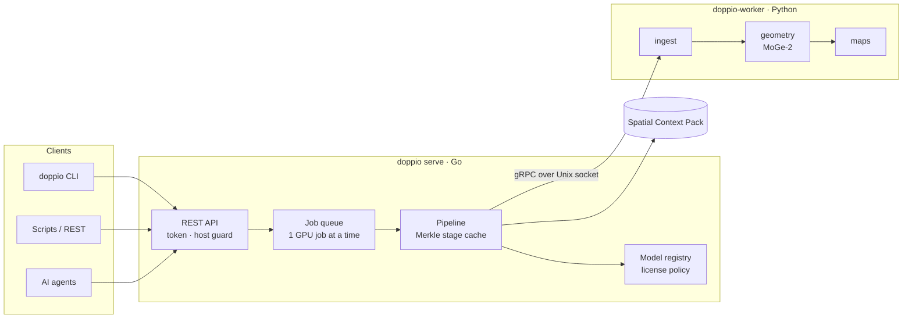

- **Go** (`cmd/`, `internal/`) owns everything except inference: the API, jobs,
  caching, license gating, pack assembly and the CLI.
- **Python** (`worker/`) runs models on MPS, CUDA or CPU. It writes large arrays
  to files; only paths and metadata cross the gRPC boundary.
- **Caching**: each stage's key hashes its own version, model revision and
  parameters together with its inputs' keys. Re-running an image reuses every
  stage, and switching the geometry model recomputes only geometry and maps.
- **Packs are verifiable**: the manifest records the SHA-256 of every
  artifact, and the CLI checks them on download.

## Security and privacy

- **Nothing leaves your machine**, except one-time model weight downloads from Hugging Face.
- The daemon binds only to loopback, requires a 256-bit bearer token (file
  mode 0600), and rejects foreign `Host` headers to block DNS-rebinding attacks
  from web pages.
- Uploads are size-limited, magic-byte checked and decoded with a pixel-bomb limit.
- See [SECURITY.md](SECURITY.md) for the threat model and private vulnerability reporting.

## Troubleshooting and FAQ

<details>
<summary><b><code>stage geometry: worker dependency missing</code></b></summary>

The MoGe backend isn't installed. Run `bin/doppio setup`, then `bin/doppio doctor`.
</details>

<details>
<summary><b>The first analysis is slow</b></summary>

It downloads model weights (134 MB to 1.2 GB) and compiles GPU kernels.
Later runs reuse both, and repeated images are served from the cache.
</details>

<details>
<summary><b><code>failed to listen on 127.0.0.1:7341</code></b></summary>

Another process (or another doppio) is using the port. Run `doppio stop`, or
choose another port with `DOPPIO_ADDR=127.0.0.1:7342` for both the daemon and the CLI.
</details>

<details>
<summary><b>How accurate is the metric depth?</b></summary>

It is a monocular estimate. Overall scale can be off, especially for
close-ups, unusual lenses or scenes without familiar objects. Keeping EXIF
(doppio uses the 35 mm focal length when present) usually helps. Treat
distances as good relative layout with approximate absolute scale.
</details>

<details>
<summary><b>Can I use the output commercially?</b></summary>

With the default settings, yes: every model used is MIT or Apache-2.0, and
`manifest.json` sets `commercial_use_ok: true`. If you pass
`--allow-noncommercial`, check that flag. Your downstream model has its own license.
</details>

<details>
<summary><b>Linux and Windows?</b></summary>

Linux should work with CUDA or on CPU. CI tests the Go code on Linux, but the
Python worker and the GPU path have so far only been tested on Apple Silicon.
Windows builds, but is untested. Reports are very welcome.
</details>

<details>
<summary><b>Where are the logs?</b></summary>

`~/Library/Application Support/doppio/logs/doppio.log` (Linux: `~/.config/doppio/logs/doppio.log`).
Worker output is prefixed with `[worker]`.
</details>

## Roadmap

- [x] **Phase 0–1**: license audit, CLI, REST API, worker, cache, depth/normal maps, camera intrinsics (geometry benchmarks pending)
- [ ] **Phase 2**: GeoCalib gravity and horizon, vanishing points, per-model ControlNet profiles, SSE progress
- [ ] **Phase 3**: segmentation (Florence-2 → SAM 2.1), planes with homographies, objects as 3D boxes, relations, annotated overlays, VLM adapter
- [ ] **Phase 4**: PLY / GLB / USD export; measure and placement queries with occlusion masks
- [ ] **Phase 5**: MCP server (`doppio mcp`)
- [ ] **Phase 6**: ComfyUI nodes
- [ ] **Phase 7**: Photoshop UXP panel
- [ ] **Phase 8**: multi-view (MapAnything); opt-in non-commercial models
- [ ] **Phase 9**: release binaries, Homebrew tap, launchd service

## Contributing

Contributions are welcome: code, templates for new models, and benchmarks on
your hardware. Start with [CONTRIBUTING.md](CONTRIBUTING.md); coding agents
should read [AGENTS.md](AGENTS.md).

```sh
make test       # gofmt, go vet, go test -race -cover, pytest
make test-it    # Go <-> real Python worker integration
make bench      # stage benchmarks → bench.json
make figures    # regenerate docs/assets
make proto      # after editing proto/
```

Please follow the [Code of Conduct](CODE_OF_CONDUCT.md). Changes are tracked
in the [CHANGELOG](CHANGELOG.md).

## License

[MIT](LICENSE) © The doppio authors.

doppio builds on [MoGe](https://github.com/microsoft/MoGe) (MIT, Microsoft).
Planned stages use the open models listed under
[Models and licenses](#models-and-licenses), each under its own license. doppio
is an independent project and is not affiliated with any model provider or
software vendor mentioned here.
