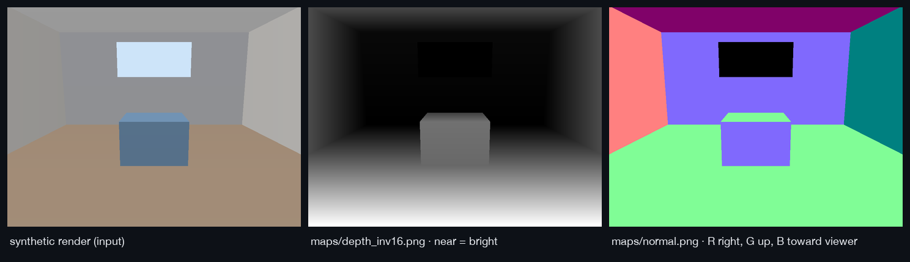

# Spatial Context Pack conventions (v1)

Every pack states these in `scene.json → conventions`; this page explains them.

| Item | Convention |
|---|---|
| Camera frame | OpenCV: x right, y down, z forward (into the scene) |
| Units | meters (MoGe-2 estimates metric scale; see `quality.metric_scale`) |
| Pixel coordinates | top-left origin, referring to the **working image** `image.png` (`image.width × image.height`), which may be downscaled from the original |
| Intrinsics | `camera.k` = [[fx,0,cx],[0,fy,cy],[0,0,1]] in working-image pixels |
| 35 mm equivalent | `focal × 43.27 mm / image diagonal` (full-frame diagonal convention) |
| Invalid geometry | `NaN` in `.npy` arrays; `0` in PNG maps (sky, no data) |

## Pack layout

```
scene.json              structured scene (camera, depth stats, quality)
manifest.json           provenance: models + licenses, stage keys, artifact sha256s
image.png               working image
maps/depth_inv16.png    16-bit inverse depth, near = bright      → depth ControlNets
maps/depth_inv8.png     8-bit inverse depth, near = bright
maps/normal.png         normals, OpenGL convention               → normal ControlNets
maps/valid_mask.png     255 valid / 0 sky or no data
arrays/points.npy       H×W×3 float32 camera-frame points (m)
arrays/depth_metric.npy H×W float32 metric depth (m)
arrays/normal.npy       H×W×3 float32 unit normals (OpenCV camera frame)
arrays/valid_mask.npy   H×W bool
```



*A synthetic, ray-cast room passed through the real encoders
(`make figures`). The window has no geometry, so it is 0 in both maps.*

## Depth maps

Inverse depth (`1/d`) over valid pixels, normalized between its 0.5th and
99.5th percentiles, clipped to [0, 1]. Near is bright, which matches the
MiDaS-style input most depth ControlNets were trained on. Use
`arrays/depth_metric.npy` when you need meters.

## Normal maps

Geometry normals come in the OpenCV camera frame. PNGs use the OpenGL
convention: `R = +x right`, `G = +y up`, `B = +z toward the viewer`, so
`(x, y, z)_gl = (x, −y, −z)_cv` and `rgb = (n + 1) / 2 × 255`. A wall facing the
camera is `(128, 128, 255)`; a floor is green-dominant.

> Some ControlNet normal models expect the red channel flipped. Per-model
> profiles that handle this come with the `controlnet` adapter in Phase 2.
> Until then, check the convention your model was trained with.

## Camera source

- `model`: field of view estimated from pixels.
- `exif+model`: the horizontal FOV was fixed from EXIF `FocalLengthIn35mmFilm`,
  and depth was solved given that FOV. Disable with `--no-exif-prior`.
